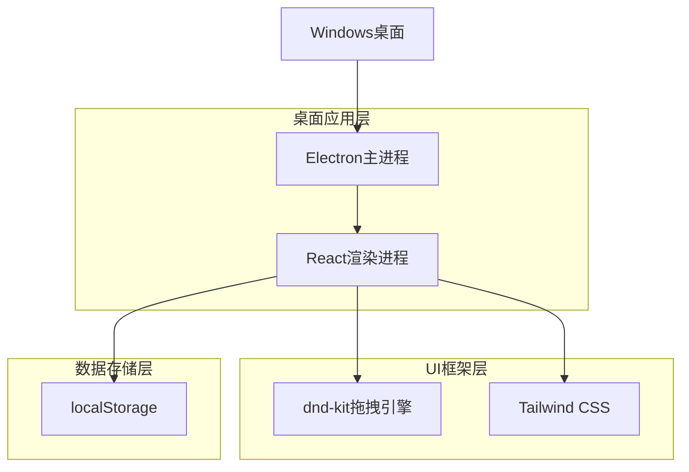
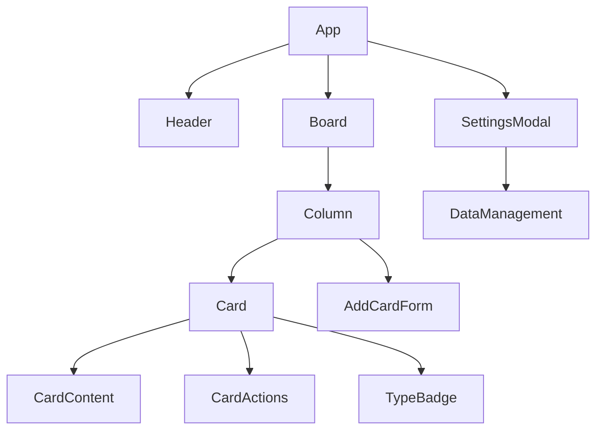

> **注**：本文档是项目初版设计稿，实际实现以 `src/` 代码与根目录 README 为准。已知差异：Electron 版本为 41（非 27）；`CardContentType` 增加了 `image`；`Card` 增加了 `expiresAt`（临时栏 TTL）与 `updatedAt`；设置页 `/settings` 尚未实现。

## 1. 架构设计



## 2. 技术描述

- **桌面框架**：Electron@41
- **前端框架**：React@18 + Vite + TypeScript
- **样式框架**：Tailwind CSS@3
- **拖拽库**：@dnd-kit/core, @dnd-kit/sortable, @dnd-kit/utilities
- **初始化工具**：electron-vite
- **打包工具**：electron-builder
- **后端服务**：无（独立桌面应用，数据存储在localStorage）

## 3. 路由定义

| 路由 | 用途 |
|------|------|
| / | 看板主页，显示多栏看板和卡片管理功能 |
| /settings | 设置页面，数据导入导出和管理功能 |

## 4. 数据结构设计

### 4.1 TypeScript类型定义

```typescript
// 卡片内容类型
type CardContentType = 'link' | 'code' | 'text' | 'image';

// 卡片颜色类型（5色）
type CardColor = 'blue' | 'green' | 'yellow' | 'red' | 'purple';

// 卡片数据结构
interface Card {
  id: string;              // 唯一标识符
  content: string;         // 卡片内容
  type: CardContentType;   // 内容类型（自动识别）
  color: CardColor;        // 卡片颜色
  isPinned: boolean;       // 是否置顶
  createdAt: number;       // 创建时间戳
  updatedAt: number;       // 更新时间戳
  expiresAt: number;       // 过期时间戳（临时栏 TTL）
  order: number;          // 在栏目中的排序
}

// 栏目数据结构
interface Column {
  id: string;              // 唯一标识符
  title: string;          // 栏目标题
  cards: Card[];          // 卡片列表
  createdAt: number;       // 创建时间戳
  order: number;          // 栏目排序
}

// 应用状态数据结构
interface AppState {
  columns: Column[];       // 所有栏目
  settings: {
    theme: 'light' | 'dark';
    autoDetectType: boolean; // 是否自动识别内容类型
  };
  version: string;         // 数据版本，用于迁移
}
```

### 4.2 localStorage键值设计

```typescript
// 主数据存储键
const STORAGE_KEYS = {
  APP_STATE: 'clipboard-hub-state',      // 主要应用数据
  BACKUP_PREFIX: 'clipboard-hub-backup-', // 备份数据前缀
};

// 默认数据结构
const DEFAULT_STATE: AppState = {
  columns: [
    {
      id: 'default-1',
      title: '待处理',
      cards: [],
      createdAt: Date.now(),
      order: 0
    },
    {
      id: 'default-2', 
      title: '已完成',
      cards: [],
      createdAt: Date.now(),
      order: 1
    }
  ],
  settings: {
    theme: 'light',
    autoDetectType: true
  },
  version: '1.0.0'
};
```

## 5. 组件架构

### 5.1 主要组件结构



### 5.2 核心组件职责

| 组件名称 | 职责 |
|---------|------|
| App | 应用主组件，状态管理，localStorage数据持久化 |
| Header | 顶部工具栏，应用标题和操作按钮 |
| Board | 看板容器，管理栏目布局和拖拽上下文 |
| Column | 栏目组件，管理栏目标题和卡片列表 |
| Card | 卡片组件，显示内容和管理卡片状态 |
| AddCardForm | 添加卡片表单，处理新卡片创建 |
| CardContent | 卡片内容显示，支持不同类型的内容渲染 |
| CardActions | 卡片操作按钮组（复制、删除、置顶、改色） |
| TypeBadge | 内容类型标签，显示自动识别的类型 |
| SettingsModal | 设置模态框，数据管理功能 |

## 6. 拖拽功能设计

### 6.1 dnd-kit集成方案

```typescript
// 拖拽上下文配置
import { DndContext, DragEndEvent, DragOverlay, closestCorners } from '@dnd-kit/core';
import { arrayMove, SortableContext, verticalListSortingStrategy } from '@dnd-kit/sortable';

// 拖拽类型定义
type DragType = 'card' | 'column';

interface DragItem {
  id: string;
  type: DragType;
  columnId?: string; // 卡片所在的栏目ID
  index: number;     // 在列表中的索引
}
```

### 6.2 拖拽操作处理

1. **栏内排序**：同一栏目内卡片重新排序
2. **跨栏移动**：卡片从一个栏目移动到另一个栏目
3. **栏目排序**：栏目在看板中的位置调整

## 7. 内容识别算法

### 7.1 自动类型识别

```typescript
function detectContentType(content: string): CardContentType {
  const trimmedContent = content.trim();
  
  // 链接识别
  const urlPattern = /^https?:\/\/[^\s/$.?#].[^\s]*$/i;
  if (urlPattern.test(trimmedContent)) {
    return 'link';
  }
  
  // 代码识别（简单规则）
  const codePatterns = [
    /^(function|const|let|var|class|import|export)\s+/,
    /[{}[\];]+/,
    /^(def|class|import)\s+/,
    /;\s*$/
  ];
  
  if (codePatterns.some(pattern => pattern.test(trimmedContent))) {
    return 'code';
  }
  
  return 'text';
}
```

## 8. 数据持久化策略

### 8.1 自动保存机制

```typescript
// 使用useEffect监听状态变化
useEffect(() => {
  localStorage.setItem(STORAGE_KEYS.APP_STATE, JSON.stringify(appState));
}, [appState]);

// 防抖处理，避免频繁写入
const debouncedSave = debounce((state: AppState) => {
  localStorage.setItem(STORAGE_KEYS.APP_STATE, JSON.stringify(state));
}, 500);
```

### 8.2 数据备份与恢复

```typescript
// 导出数据
function exportData(): void {
  const data = localStorage.getItem(STORAGE_KEYS.APP_STATE);
  const blob = new Blob([data], { type: 'application/json' });
  const url = URL.createObjectURL(blob);
  // 触发下载...
}

// 导入数据
function importData(file: File): void {
  const reader = new FileReader();
  reader.onload = (e) => {
    const data = JSON.parse(e.target.result);
    localStorage.setItem(STORAGE_KEYS.APP_STATE, JSON.stringify(data));
    // 重新加载应用...
  };
  reader.readAsText(file);
}
```

## 9. Electron桌面应用特性

### 9.1 主进程配置

```typescript
// electron/main.ts
import { app, BrowserWindow, ipcMain } from 'electron'
import { join } from 'path'

function createWindow(): void {
  const mainWindow = new BrowserWindow({
    width: 1200,
    height: 800,
    webPreferences: {
      nodeIntegration: false,
      contextIsolation: true,
      preload: join(__dirname, '../preload/preload.js')
    },
    titleBarStyle: 'hiddenInset',
    backgroundColor: '#ffffff'
  })

  if (process.env.VITE_DEV_SERVER_URL) {
    mainWindow.loadURL(process.env.VITE_DEV_SERVER_URL)
  } else {
    mainWindow.loadFile(join(__dirname, '../renderer/index.html'))
  }
}
```

### 9.2 预加载脚本

```typescript
// electron/preload.ts
import { contextBridge, ipcRenderer } from 'electron'

contextBridge.exposeInMainWorld('electronAPI', {
  getAppVersion: () => ipcRenderer.invoke('get-app-version'),
  showNotification: (message: string) => ipcRenderer.send('show-notification', message)
})
```

### 9.3 打包配置

```json
{
  "build": {
    "appId": "com.clipboard.hub",
    "productName": "剪贴板中转站",
    "directories": {
      "output": "dist-electron"
    },
    "files": [
      "dist-react/**/*",
      "electron/**/*"
    ],
    "win": {
      "target": "nsis",
      "icon": "build/icon.ico"
    }
  }
}
```

### 9.4 桌面应用优势
- **独立运行**：无需浏览器，双击即可启动
- **系统集成**：支持系统通知、任务栏图标
- **离线使用**：完全本地存储，无需网络连接
- **性能优化**：相比网页应用，响应更快
- **数据安全**：所有数据保存在本地，无需云端同步

## 10. 性能优化

### 10.1 虚拟滚动
当卡片数量较多时，考虑使用虚拟滚动技术优化渲染性能。

### 10.2 防抖节流
- 拖拽操作使用防抖处理
- 内容输入使用节流处理自动识别
- localStorage保存使用防抖优化

### 10.3 组件优化
- 使用React.memo优化卡片组件重渲染
- 合理使用useCallback和useMemo
- 拖拽状态管理优化

### 10.4 Electron特有优化
- 启用硬件加速
- 合理设置窗口大小限制
- 优化打包体积，排除不必要的依赖