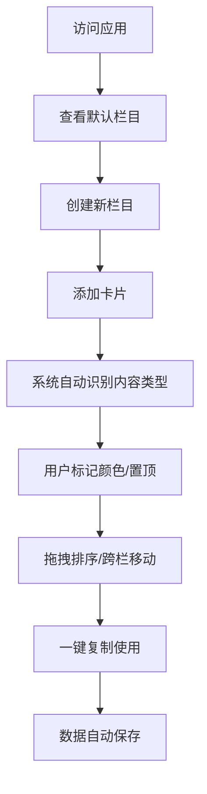

> **注**：本文档是项目初版设计稿，实际实现以 `src/` 代码与根目录 README 为准。已知差异：Electron 版本为 41（非 27）；`CardContentType` 增加了 `image`；`Card` 增加了 `expiresAt`（临时栏 TTL）与 `updatedAt`；设置页 `/settings` 尚未实现。

## 1. 产品概述

剪贴板中转站是一个Windows桌面应用，帮助用户管理和组织剪贴板内容。用户可以将复制的文字、链接、代码等内容保存到不同的看板栏目中，支持智能分类、拖拽排序和颜色标记。作为独立的桌面软件运行，无需浏览器。

目标用户：需要频繁复制粘贴内容的办公人员、开发者、内容创作者，解决剪贴板内容管理混乱的问题。

## 2. 核心功能

### 2.1 用户角色 

本产品为单用户应用，无需注册登录，所有数据本地存储。

### 2.2 功能模块

剪贴板中转站包含以下主要页面：

1. **看板主页**：多栏看板布局，显示所有栏目和卡片内容
2. **设置页面**：数据导入导出、清空数据等管理功能

### 2.3 页面详情

| 页面名称 | 模块名称 | 功能描述                              |
| ---- | ---- | --------------------------------- |
| 看板主页 | 栏目管理 | 新建栏目、删除栏目、重命名栏目标题                 |
| 看板主页 | 卡片管理 | 添加新卡片、编辑卡片内容、删除卡片、置顶卡片、选择卡片颜色（5色） |
| 看板主页 | 内容识别 | 自动识别链接、代码片段、普通文字并添加相应标签           |
| 看板主页 | 拖拽功能 | 栏内卡片排序、跨栏卡片移动                     |
| 看板主页 | 快捷操作 | 一键复制卡片内容到剪贴板                      |
| 设置页面 | 数据管理 | 导出数据、导入数据、清空所有数据                  |

## 3. 核心流程

### 用户使用流程

1. 用户首次访问看到默认栏目和示例卡片
2. 用户可以创建新栏目来分类管理内容
3. 用户复制内容后，点击"添加卡片"按钮粘贴内容
4. 系统自动识别内容类型（链接/代码/普通文字）并添加标签
5. 用户可以给卡片选择颜色进行优先级标记
6. 用户可以通过拖拽调整卡片顺序或在不同栏目间移动
7. 用户可以点击一键复制按钮快速复制卡片内容
8. 所有操作自动保存到localStorage，刷新页面数据不丢失

## 4. 用户界面设计

### 4.1 设计风格

* **主色调**：现代简洁风格，主色为蓝色系（#3B82F6），辅助色为灰色系

* **按钮样式**：圆角矩形，悬停效果，主要操作为实心按钮，次要操作为边框按钮

* **字体**：系统默认字体，标题16px，正文14px，小字12px

* **布局风格**：看板式布局，栏目横向排列，卡片在栏目内垂直排列

* **图标风格**：使用简洁的线性图标，表示复制、删除、置顶等操作

### 4.2 页面设计概览

| 页面名称 | 模块名称  | UI元素                      |
| ---- | ----- | ------------------------- |
| 看板主页 | 顶部工具栏 | 应用标题、添加栏目按钮、设置按钮          |
| 看板主页 | 栏目区域  | 栏目标题（可编辑）、卡片计数、删除按钮       |
| 看板主页 | 卡片列表  | 卡片容器、内容预览、类型标签、颜色标记、操作按钮组 |
| 看板主页 | 添加卡片  | 文本输入框、确认按钮、取消按钮           |
| 设置页面 | 数据管理  | 导出按钮、导入文件选择、清空确认对话框       |

### 4.3 响应式设计

* **桌面优先**：主要面向桌面端用户，充分利用屏幕空间

* **移动端适配**：在移动设备上自动调整为垂直滚动布局

* **触摸优化**：拖拽操作在触摸设备上也能流畅使用

### 4.4 交互细节

* 卡片悬停显示完整操作按钮组

* 拖拽时显示半透明预览效果

* 内容识别标签使用不同颜色区分（链接蓝色、代码绿色、普通文字灰色）

* 置顶卡片显示特殊标记并固定在栏目顶部

* 一键复制成功后显示短暂的成功提示

